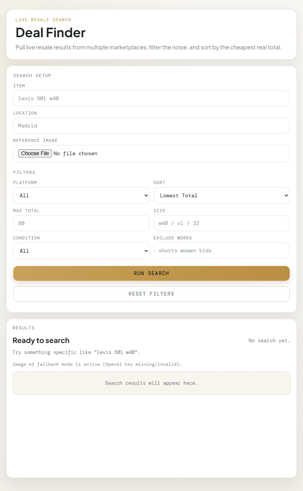

Vintage & Secondhand Deal Finder

A personal project that runs locally and finds secondhand and vintage fashion pieces across multiple resale platforms, sorted by total landed price including shipping to your location.

What it does

Searches Vinted, eBay, and Wallapop simultaneously
Estimates shipping cost based on your destination
Sorts results by total landed price, not just item price
Filters by platform, condition, size, price cap, and excluded keywords

Tech stack

Node.js + Express (backend)
Puppeteer (Vinted + Wallapop scraping)
eBay Browse API (official)
Vanilla HTML/CSS/JS (frontend)

Run it locally

Clone the repo
Run npm install
Copy `.env.example` to `.env` and add your eBay API credentials. Set `OPENAI_API_KEY` to enable image search with vision; text search works without it.
Run npm start
Open http://localhost:3000

Platforms

Vinted
eBay
Wallapop
Grailed (coming soon)
Depop (coming soon)
